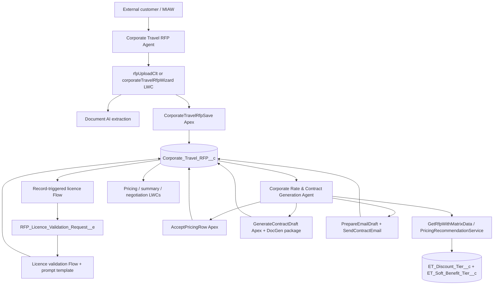

# Ethiopian Airlines Agentforce: replication guide

## Scope and evidence

This guide describes the Salesforce DX source in `force-app/main/default` as it exists in this repository. The intended product has two agents: an external corporate RFP intake agent and an internal corporate rate/contract agent. The repository contains their top-level `AiAgentDefinition` metadata and a sizeable set of related Apex, LWC, custom-object, and Flow files.

The supplied PDF is at `C:\Users\awokege\Documents\Ethiopian Airlines Agentforce - Solution Design Document.pdf`. Its content was not extractable in this environment, so PDF-specific statements cannot be independently compared here. Treat the end-to-end narrative below as a source-code reconstruction, not a verified transcription of the PDF. Agent topic/action instructions and org configuration may exist only in Salesforce and are not represented by the two top-level agent definition XML files.

## Architecture at a glance

The two agents are declared in:

| Agent | Source metadata | Declared type | What this file confirms |
|---|---|---|---|
| Corporate Travel RFP Agent | `aiAgents/Corporate_Travel_RFP_Agent.aiAgentDefinition-meta.xml` | `EinsteinServiceAgent`, `ExternalCopilot` | Description says it guides corporate clients through submitting an RFP. It does not include topic instructions or action mappings. |
| Corporate Rate & Contract Generation | `aiAgents/Corporate_Rate_Contract_Generation.aiAgentDefinition-meta.xml` | `AgentforceEmployeeAgent`, `InternalCopilot` | Agent name/description and type only. It does not include internal topics or action mappings. |

An AI agent is not implemented by an Apex class alone. Topics, instructions, action bindings, channels, identity, and activation must also be configured and deployed. This repo does not show enough to reconstruct that layer by itself.

## Agent 1: external RFP intake

### Likely customer journey

1. A customer starts a messaging session and the external agent gathers corporate RFP details. The agent definition identifies the external purpose but not its actual conversational steps.
2. The customer uploads an RFP or business licence through a Chat Lightning Template (CLT) LWC. The two likely entry points are `lwc/rfpUploadClt` for chat upload/extraction and `lwc/corporateTravelRfpWizard` for a form-style wizard. There are Flow output wrappers for both components.
3. Upload code creates a Salesforce File (`ContentVersion`, then `ContentDocument`). `RfpUploadController.uploadAndExtract` can call Document AI synchronously and store extraction output in `ET_RFP_Extract__c`. `DocumentAiRfpExtractor` is an invocable action for an Agentforce/Flow-driven extraction path; it can consume a document ID, messaging session, or base64 chunks and reuses cached extraction when available.
4. Extracted data is presented for confirmation/correction. The LWC sends a chat utterance to the embedded messaging utility. `CorporateTravelRfpWizardData` and `RfpUploadCltData` supply their Flow component data contracts; `corporateTravelRfpWizard_Output`, `rfpUploadClt_Output`, and `businessLicenceUploadClt_Output` shape outputs/options.
5. `CorporateTravelRfpSave.saveRfpFromLwc` or the Flow-invocable save method parses submitted JSON and creates the RFP and related agency/route data. It returns record ID and a confirmation result. The `corporateTravelRfpSave_Output` Flow maps the action response.
6. `corporateTravelRfpNewSubmission` is an active after-save record-triggered Flow that creates a review Task.
7. Business licence validation is asynchronous: active `Business_Licence_Validation_on_RFP_Create` publishes `RFP_Licence_Validation_Request__e`; active `Licence_Validation_Worker` gets the RFP/file, invokes the validation prompt template, parses the JSON using `LicenceValidationParser`, and updates licence fields on the RFP.

### Main intake components

| Component | Role |
|---|---|
| `lwc/rfpUploadClt` | Chat upload UI. Calls `RfpUploadController.uploadAndExtract`; renders extraction state and sends the extraction summary/fields back into chat. |
| `lwc/businessLicenceUploadClt` | Business licence upload UI. Calls `uploadFileOnly`; intended to pass the uploaded document to the agent-side validation path. |
| `lwc/corporateTravelRfpWizard` | Multi-step intake UI; uploads documents and invokes `CorporateTravelRfpSave.saveRfpFromLwc`. |
| `classes/RfpUploadController.cls` | Creates Salesforce Files, stages extraction records, and offers a synchronous Document AI callout endpoint. |
| `classes/DocumentAiRfpExtractor.cls` | Invocable extraction service, with cached result lookup and messaging-session document resolution. |
| `classes/CorporateTravelRfpSave.cls` | JSON-to-record save logic, both Aura-enabled and Flow-invocable. |
| `classes/CorporateTravelRfpWizardData.cls`, `RfpUploadCltData.cls` | Flow/CLT-facing data contracts. |
| `classes/LicenceValidationParser.cls` | Converts prompt JSON response to typed validation results. |
| `flows/Business_Licence_Validation_on_RFP_Create.flow-meta.xml` | Publishes the validation platform event after RFP creation. |
| `flows/Licence_Validation_Worker.flow-meta.xml` | Active worker that calls the prompt and writes parsed validation data. |
| `lwc/licenceAnalystNotes`, `businessLicenceViewer` | Record page views for validation notes and the stored licence file. |

### Document AI callout

Both extraction classes point at `callout:DocumentAI_NC/...` and use schema/configuration name `ET_Corporate_RFP`. This implies a Named Credential called `DocumentAI_NC` and a Document AI configuration in the org. The code alone does not provide the credential URL/authentication, permissions, or configuration schema. `RfpUploadController` has three routes:

- `uploadDocumentOnly`: store file only.
- `uploadFileOnly`: store file and an `ET_RFP_Extract__c` staging row, for agent-side extraction.
- `uploadAndExtract`: call Document AI before DML, then store the file and extracted values.

The two extraction routes overlap. Confirm which one is actually mapped in each agent/Flow before replicating; otherwise extraction could be duplicated or one path could only save an unprocessed file.

## Agent 2: internal pricing and contract process

### Pricing conversation and decision

1. The internal agent should identify the target RFP record. `AutoDetectRfpContext` is an invocable helper for resolving context from conversation/user input; the actual topic instruction and action call are not in the visible agent metadata.
2. `GetRfpWithMatrixData` loads the RFP and qualifying discount and soft-benefit tiers, returns all matrix rows and a human-readable rate assessment/negotiation brief. `PricingRecommendationService` separately calculates the default recommendation and summarizes rows/benefits. An active pricing Flow is not present: `Pricing_Recommendation_on_NFR_Change` is marked **Obsolete**.
3. `lwc/rfpNegotiationBriefRenderer` displays a negotiated matrix/brief in an agent response. `lwc/pricingRecommendationCard` reads current saved offer data through `GetRfpOfferData`; `lwc/rfpSummaryCard` summarizes the record.
4. `AcceptPricingRow.accept` writes a selected row into `Offer_*` fields on `Corporate_Travel_RFP__c`. Row 1 is the default. Row 2+ or an optional Rule 2 uplift sets escalation fields and attempts submission into Salesforce Approval. The approval submission exception is caught and only debug-logged, so a “Pending” field can be written even if the approval engine did not accept the submission. Validate the actual Approval Process and decide how to surface failures.
5. `GetRfpOfferData.getOfferData` supplies the pricing card and soft benefits from the stored offer/tier data.

### Contract generation and email

1. `GenerateContractDraft.generate` is the Flow/agent action that checks the offer and approval gate, prepares token values, calls the managed document-generation package, and records generated contract/version/content information on the RFP. `RfpDocGenTokenProvider` implements `ind_docgen_api.OpenInterface`, providing token values to that package.
2. `lwc/contractEmailDraftCard` renders a prepared email. `PrepareEmailDraft.prepare` builds the draft values from the RFP and related offer/contract data.
3. `SendContractEmail.send` sends the email, attaches the generated contract file, and updates the RFP status on success. This differs from `SendEmailApexController`, which is a Case email-history/send controller and appears to be a separate/legacy feature, not the RFP contract path.
4. `lwc/businessLicenceViewer` and pricing/summary components expose the record state to staff. The `Corporate_Travel_RFP_Record_Page` flexipage is part of the admin UI.

### Main pricing/contract components

| Component | Purpose |
|---|---|
| `GetRfpWithMatrixData` | Agent-facing RFP, matrix, and negotiation context lookup. |
| `PricingRecommendationService` | Returns qualifying tier, default row, all discount rows, and active soft benefits. |
| `AcceptPricingRow` | Persists offer selection, escalation and optional uplift; attempts Approval submission. |
| `GetRfpOfferData` | UI-facing read of the current offer and approval status. |
| `GenerateContractDraft` | Contract document generation with approval guard. |
| `RfpDocGenTokenProvider` | Managed-package token provider. |
| `PrepareEmailDraft`, `SendContractEmail` | Draft and send the RFP contract email. |
| `rfpNegotiationBriefRenderer`, `pricingRecommendationCard`, `contractEmailDraftCard`, `rfpSummaryCard` | Agent response and record-level UI. |

## Data model and Salesforce metadata

The main records found in source are:

- `Corporate_Travel_RFP__c`: central submission, company/contact, budget/NFR, status, document references, licence validation, offer/approval, and contract fields.
- `ET_Discount_Tier__c`: NFR range, matrix row, discount percentages, routing scope and soft-option count.
- `ET_Soft_Benefit_Tier__c`: benefits by NFR range (tickets, date changes, baggage, upgrades, lounge, hotel).
- `ET_RFP_Extract__c`: Document AI extraction cache/staging.
- `Travel_Agency__c`, `Travel_Route__c`: associated agency and route details.
- `RFP_Licence_Validation_Request__e`: referenced in Flow but no platform-event object metadata was found in this source tree.

Object metadata files define fields and relationships, but the repository does not prove that the org contains the required production data rows. Pricing tiers and soft-benefit tiers must be seeded/migrated separately. Replication also needs the required picklist values, record types, layouts, validation rules, and sharing model verified against the org.

## What is missing or external to this source download

These are concrete source-tree gaps or dependencies, not proof that the live org lacks them:

1. **Agent build details.** The two `aiAgentDefinition` files are shells. No Agentforce topic/instruction/action binding source was found. Export the full agent metadata/configuration from the org, including topics, action order, input/output mappings, guardrails, channels and activation details.
2. **Validation prompt template.** `Licence_Validation_Worker` references a prompt template action, but no Prompt Builder template metadata was found. Retrieve the exact template, its inputs/output schema, model/settings and access configuration.
3. **Platform event metadata.** Two Flows reference `RFP_Licence_Validation_Request__e`, but no `objects/RFP_Licence_Validation_Request__e` metadata exists in this project. Retrieve the event object and fields, and confirm subscriber/Flow version activation.
4. **Flow status mismatch.** `Licence_Validation_PE_Subscriber` is **Draft**, while `Licence_Validation_Worker` is **Active**. Both are event-subscriber-shaped flows. Confirm which version is intended to run; an active-looking worker plus a draft subscriber is not sufficient evidence of a working async chain.
5. **Named Credential and Document AI setup.** No Named Credential or External Credential metadata was found, although both extraction implementations call `DocumentAI_NC`. Retrieve credential metadata (without secrets), auth principal access, permission sets, Document AI configuration `ET_Corporate_RFP`, and required API/feature setup.
6. **Document generation package.** `GenerateContractDraft` depends on `ind_docgen_api` and the `ind_docgen` package. The package, template files/IDs, package license, token schema, and required permissions are external dependencies. `RfpDocGenTokenProvider` cannot run without them.
7. **Approval process.** `AcceptPricingRow` calls `Approval.process`, but no Approval Process metadata or approver routing was found. Retrieve criteria, steps, submitter permissions, queue/user assignments, and approval status updates.
8. **Email/org configuration.** Confirm org-wide sender/reply-to configuration, deliverability, email templates/branding assets, permissions and attachment access. A logo referenced by the email builder is not present as a static resource in the source tree.
9. **Agent runtime and site setup.** The external agent likely depends on Messaging for In-App and Web (MIAW), Embedded Service deployment, channel routing, guest/agent user, site/Experience Cloud configuration and CLT placement. These are not fully represented here.
10. **Permission model.** No permission sets were found in the source tree. Retrieve Apex class access, object/field permissions, file access, Named Credential principal access, agent-user permissions, and record sharing configuration.
11. **Unrelated unresolved code dependencies.** `corporateContractProposalForm` imports `LeadContractProposalController` and `FileSecurityService`; `rfpProposalAndRequest` references `Proposal_Version__c`. Those referenced classes/object do not appear in this source listing. They may be another feature omitted from the download. They are not required by the described two-agent RFP flow unless the PDF explicitly includes the proposal workflow.

`Pricing_Recommendation_on_NFR_Change` is Obsolete and should not be counted as active automation. `Licence_Validation_PE_Subscriber` is Draft and should not be counted as active automation either.

## Important code observations before copying

- **Two competing extraction paths:** one Apex LWC callout and one invocable agent action both call Document AI. The invocable action caches extraction results, but `uploadFileOnly` creates a staging row without extracted JSON. Verify which route the agent actually uses.
- **Guest/security boundary:** upload/save and preview classes include `without sharing`. Review record/file access and input handling before exposing them to an unauthenticated web visitor. The app needs a deliberate guest-user security design.
- **Approval can fail silently:** `AcceptPricingRow` catches approval engine exceptions without returning failure. The record can show `Pending` when submission failed; check Approval Process metadata and improve this behavior before production replication.
- **Data/model alignment:** `PricingRecommendationService` and `AcceptPricingRow` select by the NFR range and row number. Ensure exactly one tier row per range/row and a defined policy for gaps/overlaps. Soft benefit rows are selected independently by range.
- **RFP save is a trust boundary:** JSON arrives from the client/chat experience. Verify field allowlisting, required-field validation, duplicate submission handling, file ownership/linking, and transactional rollback in `CorporateTravelRfpSave` before treating the values as trusted.
- **Document size and callout limits:** base64-in-JSON upload and `VersionData` reads can become large. Confirm file-size limits and consider asynchronous processing for large documents.
- **Email controller separation:** `SendEmailApexController` is Case-based and not interchangeable with the RFP-specific `SendContractEmail` action.
- **Testing:** Apex test classes exist for most important services. This inspection did not execute tests or deploy metadata; successful local source presence does not establish org deployability.

## Replication checklist

1. Retrieve the PDF content in readable form and cross-check each workflow against this source-based interpretation.
2. From the source org, retrieve full Agentforce agent metadata/configuration (topics, instructions, actions and mappings), prompt templates, platform events, all Flow versions, approval process, Named/External Credentials, permission sets, layouts/record pages, MIAW/Embedded Service/Experience configuration, and DocGen package/template setup.
3. Retrieve all referenced custom objects and fields, including `RFP_Licence_Validation_Request__e`; compare source against org inventory for absent files and inactive/draft versions.
4. Export and load `ET_Discount_Tier__c` and `ET_Soft_Benefit_Tier__c` business data. Validate the tier ranges and row definitions with the business owner.
5. Resolve external class/object dependencies or remove unrelated components from the deployment package.
6. Configure credentials and secrets in the target org; never copy credentials into source control.
7. Deploy in dependency order: schema and platform event → Apex and tests → credentials/permissions/integrations → prompt template and flows → Agentforce topics/actions → channel and page deployment → seed pricing data → activate.
8. Exercise the full journey in a sandbox: customer upload, extraction, edits, save, review task, async licence validation, agent pricing options, default offer, escalation approval, contract generation, email draft and send.

## Source file index

Paths below are relative to `force-app/main/default`:

- Agents: `aiAgents/Corporate_Travel_RFP_Agent.aiAgentDefinition-meta.xml`, `aiAgents/Corporate_Rate_Contract_Generation.aiAgentDefinition-meta.xml`
- Main Apex: `classes/RfpUploadController.cls`, `classes/DocumentAiRfpExtractor.cls`, `classes/CorporateTravelRfpSave.cls`, `classes/AutoDetectRfpContext.cls`, `classes/GetRfpWithMatrixData.cls`, `classes/PricingRecommendationService.cls`, `classes/AcceptPricingRow.cls`, `classes/GetRfpOfferData.cls`, `classes/GenerateContractDraft.cls`, `classes/RfpDocGenTokenProvider.cls`, `classes/PrepareEmailDraft.cls`, `classes/SendContractEmail.cls`, `classes/LicenceValidationParser.cls`
- Intake Flows: `flows/rfpUploadClt_Output.flow-meta.xml`, `flows/businessLicenceUploadClt_Output.flow-meta.xml`, `flows/corporateTravelRfpWizard_Output.flow-meta.xml`, `flows/corporateTravelRfpSave_Output.flow-meta.xml`, `flows/corporateTravelRfpNewSubmission.flow-meta.xml`
- Licence Flows: `flows/Business_Licence_Validation_on_RFP_Create.flow-meta.xml`, `flows/Licence_Validation_Worker.flow-meta.xml`, `flows/Licence_Validation_PE_Subscriber.flow-meta.xml`
- Pricing Flow: `flows/Pricing_Recommendation_on_NFR_Change.flow-meta.xml` (Obsolete)
- LWCs: `lwc/rfpUploadClt`, `lwc/businessLicenceUploadClt`, `lwc/corporateTravelRfpWizard`, `lwc/rfpNegotiationBriefRenderer`, `lwc/pricingRecommendationCard`, `lwc/contractEmailDraftCard`, `lwc/rfpSummaryCard`, `lwc/licenceAnalystNotes`, `lwc/businessLicenceViewer`
- Record page: `flexipages/Corporate_Travel_RFP_Record_Page.flexipage-meta.xml`

